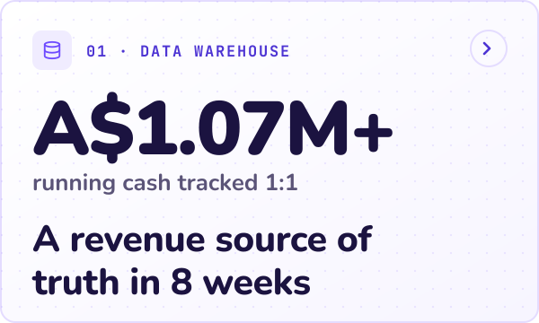
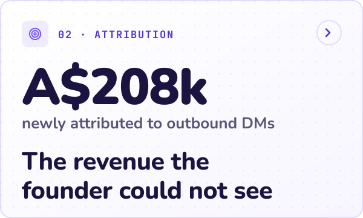
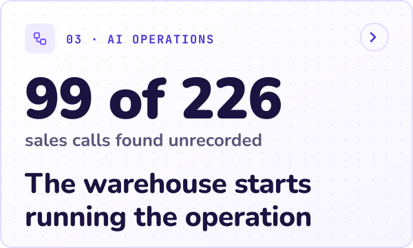
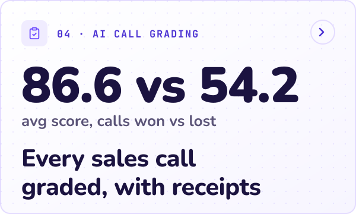
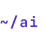

<a href="https://marcturtal.com"><picture><source media="(prefers-color-scheme: dark)" srcset="assets/banner-dark.svg"></picture></a>

I build the data and AI infrastructure revenue teams run on: warehouses, attribution, and AI access layers that let a founder ask their numbers a question in plain English. **12+ years** across fintech, e-commerce and SaaS. One person delivering team-level scope by working AI-native.

<a href="https://marcturtal.com"><picture><source media="(prefers-color-scheme: dark)" srcset="assets/contact/website-dark.svg"></picture></a>
<a href="https://www.linkedin.com/in/mturtal/"><picture><source media="(prefers-color-scheme: dark)" srcset="assets/contact/linkedin-dark.svg"></picture></a>
<a href="mailto:contact@marcturtal.com"><picture><source media="(prefers-color-scheme: dark)" srcset="assets/contact/email-dark.svg"></picture></a>
<a href="https://marcturtal.com/resume/"><picture><source media="(prefers-color-scheme: dark)" srcset="assets/contact/resume-dark.svg"></picture></a>

### ~/ what I build

- **Revenue data warehouses.** A Postgres source of truth that unifies every revenue tool.
- **Revenue attribution.** Every sale tied to its channel, from first touch to cash collected.
- **AI access layers.** MCP servers and Claude integrations, so a team queries its data in plain English.
- **Automation and bots.** Unattended pipelines, AI triage desks and reports that post themselves.
- **Fractional AI and RevOps leadership.** Director-level ownership of the data and AI roadmap.

### ~/ featured work

<a href="https://marcturtal.com/work/revenue-warehouse/"><picture><source media="(prefers-color-scheme: dark)" srcset="assets/work/revenue-warehouse-dark.svg"></picture></a>
<a href="https://marcturtal.com/work/dm-attribution/"><picture><source media="(prefers-color-scheme: dark)" srcset="assets/work/dm-attribution-dark.svg"></picture></a>

<a href="https://marcturtal.com/work/ai-operations-layer/"><picture><source media="(prefers-color-scheme: dark)" srcset="assets/work/ai-operations-layer-dark.svg"></picture></a>
<a href="https://marcturtal.com/work/call-grading/"><picture><source media="(prefers-color-scheme: dark)" srcset="assets/work/call-grading-dark.svg"></picture></a>

Four case studies from one 2026 build for Company | Confidential. More on <a href="https://marcturtal.com/work/">marcturtal.com/work</a>.

### ~/ track record

- **Director, AI & Automations** · Company | Confidential · 2026 to present
- **Senior Technology and AI Manager** · JPMorganChase · 62% operational speed lift from an internal AI platform
- **GTM & Marketing Automation Specialist** · My Amazon Guy · $51,568 single-day webinar funnel
- **Technical Account Manager, Payments RevOps** · Payreto · 800k+ EUR monthly processing volume added
- **Earlier** · Google, Telstra, DirecTV

### ~/ stack

<picture><source media="(prefers-color-scheme: dark)" srcset="assets/stack/_data-dark.svg"></picture>
<picture><source media="(prefers-color-scheme: dark)" srcset="assets/stack/postgresql-dark.svg"></picture>
<picture><source media="(prefers-color-scheme: dark)" srcset="assets/stack/supabase-dark.svg"></picture>
<picture><source media="(prefers-color-scheme: dark)" srcset="assets/stack/python-dark.svg"></picture>
<picture><source media="(prefers-color-scheme: dark)" srcset="assets/stack/typescript-dark.svg"></picture>

<picture><source media="(prefers-color-scheme: dark)" srcset="assets/stack/_ai-dark.svg"></picture>
<picture><source media="(prefers-color-scheme: dark)" srcset="assets/stack/claude-code-dark.svg"></picture>
<picture><source media="(prefers-color-scheme: dark)" srcset="assets/stack/mcp-dark.svg"></picture>
<picture><source media="(prefers-color-scheme: dark)" srcset="assets/stack/gemini-dark.svg"></picture>

<picture><source media="(prefers-color-scheme: dark)" srcset="assets/stack/_automation-dark.svg"></picture>
<picture><source media="(prefers-color-scheme: dark)" srcset="assets/stack/n8n-dark.svg"></picture>
<picture><source media="(prefers-color-scheme: dark)" srcset="assets/stack/zapier-dark.svg"></picture>
<picture><source media="(prefers-color-scheme: dark)" srcset="assets/stack/hubspot-dark.svg"></picture>

<picture><source media="(prefers-color-scheme: dark)" srcset="assets/stack/_web-dark.svg"></picture>
<picture><source media="(prefers-color-scheme: dark)" srcset="assets/stack/php-dark.svg"></picture>
<picture><source media="(prefers-color-scheme: dark)" srcset="assets/stack/vue-dark.svg"></picture>

### ~/ writing

- [An MCP server that lets executives query Postgres](https://marcturtal.com/writing/mcp-server-for-executives/)
- [Building a revenue data warehouse solo in 8 weeks](https://marcturtal.com/writing/revenue-warehouse-in-8-weeks/)
- [AI triage desk: meeting transcripts to approved tasks](https://marcturtal.com/writing/triage-desk-that-reads-the-meetings/)
- [All writing](https://marcturtal.com/writing/)

### ~/ side projects

- [**Buzzcord**](https://github.com/mtits/Buzzcord) · a lightweight, old-school messenger for Discord (unofficial), in C# and WinForms
- [**phgiftideas.com**](https://phgiftideas.com) · an AI gift finder on Gemini
- [**app.marcturtal.com**](https://app.marcturtal.com) · my desktop apps

Most of my work lives in private client repos, so the case studies are the portfolio.
